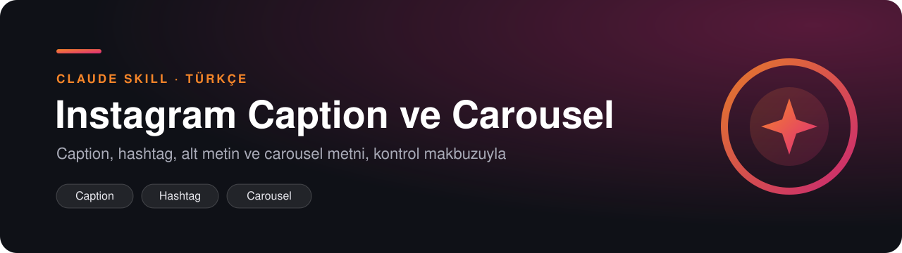

<p align="center"></p>

<p align="center">
  
  
  
</p>

<p align="center"><b>Caption, hashtag, alt metin ve carousel metni, kontrol makbuzuyla</b></p>

---

## ✨ Ne yapar

Instagram caption, hashtag, alt metin ve 1080×1350 carousel slayt metinlerini yazan, sonra bunları bir kural listesine göre denetleyip sayılarla bir makbuz basan bir Claude skill'i.

- **Önce görevi seçer:** Görev A (Reels kancayı zaten taşıyor; caption bağlam ve tek çağrı verir) veya Görev B (caption içeriğin kendisi; ilk satır kanca).
- **Hashtag'de güncel:** Instagram'ın gönderi başına 5 etiket sınırı (Aralık 2025) ve düz cümle içindeki arama terimlerinin neden daha önemli olduğu.
- **Carousel yapısı:** 6–10 slayt, kapak ≤6 kelime, slayt başına tek fikir, ≤25 kelime, ekran görüntüsü alınmak için tasarlanmış özet slaytı.
- **Makbuz:** kesimden önce görünen karakter, çağrı sayısı, hashtag, arama terimi yeri, link, emoji yoğunluğu.

## 🧾 Örnek çıktı

```
CAPTION HAZIR
görev:       A - kancayı reel taşıyor
görünen:     125 karakterin 118'i kesimden önce kullanıldı
çağrı:       1 (kaydet)
hashtag:     3
emoji:       100 karakterde 1,2
```

## 💬 Nasıl kullanılır

Skill'i yükledikten sonra Claude'a doğal dilde yazman yeterli:

> "Bu Reels için caption yaz: Dyson'ın 5.126 prototip hikayesi."  
> "Toyota'nın 5 Neden yöntemini 8 slaytlık carousel yap."  
> "Bu caption'ı kontrol et, makbuzu göster."  

## ⚙️ Kurulum

**Claude Code**
```bash
git clone https://github.com/erencalik/instagram-aciklama-carousel-metni-claude.git ~/.claude/skills/instagram-aciklama-carousel-metni
```
**claude.ai:** repoyu ZIP olarak indir (Code → Download ZIP) ve Ayarlar → Yetenekler → Skills altından yükle.

<details>
<summary>Dosyalar</summary>

| | |
|---|---|
| `SKILL.md` | skill talimatları |
| `README.md` | bu sayfa |
| `assets/banner.svg` | banner |
| `LICENSE` | MIT |

</details>

## 🔗 Birlikte çalıştığı skill'ler

| Repo | Ne yapar |
|---|---|
| [`sosyal-medya-metni-insanlastirma-claude`](https://github.com/erencalik/sosyal-medya-metni-insanlastirma-claude) | Türkçe metinden yapay zeka izlerini temizler, beş kontrolle puanlar |
| [`instagram-carousel-design-system-claude`](https://github.com/erencalik/instagram-carousel-design-system-claude) | From a brand interview to pixel-checked 1080×1350 PNG slides |
| [`instagram-weekly-content-planner-claude`](https://github.com/erencalik/instagram-weekly-content-planner-claude) | Weekly plan, niche research and post audits, ranked by evidence |

Tüm skill'ler ve aralarındaki akış için: [`claude-skills-collection`](https://github.com/erencalik/claude-skills-collection)

## 📄 Kaynak ve lisans

[Jakeschincariol/instagram-agent-skill](https://github.com/Jakeschincariol/instagram-agent-skill) (MIT) içindeki `ig-caption` ve `ig-carousel` skill'lerinden uyarlanmıştır; Python linter yerine Claude'un kendisinin uyguladığı bir kontrol listesi kullanılır. MIT lisanslı, bkz. [LICENSE](LICENSE).
